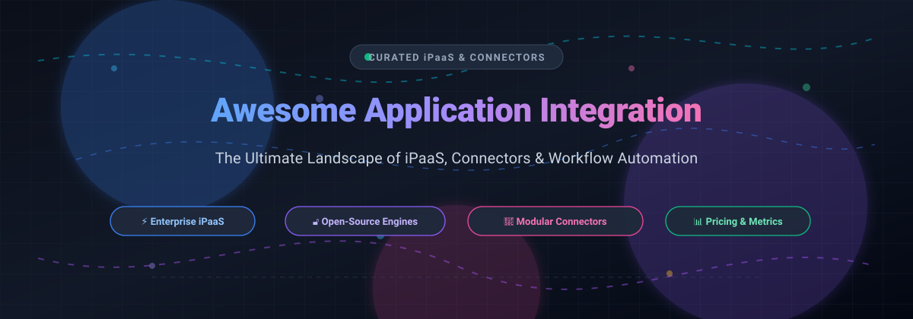

  

# Awesome Application Integration Connectors 🚀

  
  
  
  
  
  
  

A curated directory and guide to the best **Application Integration Connectors**, **Integration Platform as a Service (iPaaS)** software, **open-source workflow automation engines**, and **ETL/ELT data orchestration pipelines**.

Whether building mission-critical enterprise ESB microservices, low-code departmental automations, self-hosted fair-code bots, or serverless event-driven API workflows, this reference provides real-world transparent pricing benchmarks, free tier limits, star counts, and architectural features.

---

## 📑 Table of Contents
- [🌐 Sector Overview & Market Dynamics](#-sector-overview--market-dynamics)
- [💼 SaaS Integration Platforms & Connectors](#-saas-integration-platforms--connectors)
- [🔓 Open-Source Integration & Workflow Engines](#-open-source-integration--workflow-engines)
- [🤝 Contributing](#-contributing)
- [⭐ Star History](#-star-history)
- [💖 Support](#-support)

---

## 🌐 Sector Overview & Market Dynamics

The global **Integration Platform as a Service (iPaaS)** market is estimated between **$8.5B and $10.9B** (projected to exceed $30B+ by 2030 at a rapid 20–30% CAGR). The market structure is **moderately concentrated** at the high-end enterprise layer—dominated by cloud and middleware giants including Salesforce (MuleSoft), Microsoft, Oracle, and Boomi—yet remains **highly fragmented** across mid-market, SMB, and developer tiers where specialized low-code platforms, AI-driven automation builders, and modular open-source orchestrators fiercely compete.

---

## 💼 SaaS Integration Platforms & Connectors

The table below catalogs premier commercial SaaS iPaaS solutions and workflow automation platforms, ordered in descending order by **company size (valuation or revenue)**.

| Vendor / Product | 🏢 Company Size (Valuation / Revenue) | 💰 Starting Pricing (Specific Tier) | 🎁 Free Tier / Trial Limit | ⚙️ Architecture & Features |
|---|---|---|---|---|
| **MuleSoft** | **$6.5B acquisition valuation** (Salesforce parent; ~$350M+ ARR) | **$2,000/month** (billed annually for Integration Starter package) | **30-day free trial** (Full Anypoint Platform access; no credit card required) | Full enterprise API lifecycle management, Anypoint Platform, runtime fabric, and MuleSoft Composer for business teams. |
| **Workato** | **$5.7B valuation** (Series E; ~$150M ARR) | **$75/month** (Pro plan base for 2,500 credits; scales to $1,275/mo for 50,000 credits) | **Free tier: 50,000 one-time credits** (never expire; recipe creation & testing) | Enterprise automation, AI orchestration, bot integrations (Workbot), and governed business workflow recipes. |
| **Zapier** | **$5.0B valuation** (~$310M ARR) | **$19.99/month** (Starter plan, billed annually at $239.88/yr for 750 tasks/mo) | **Free forever plan: 100 tasks/month**, unlimited zaps, 15-minute update cycles | Mass-market leader with 7,000+ app connectors, multi-step zaps, built-in tables, and AI workflow generators. |
| **Boomi** | **$4.0B valuation** (~$500M ARR; Francisco Partners / TPG) | **$99/month** (Pay-As-You-Go base tier + $0.05 per Boomi message document) | **30-day free trial** (Full Enterprise Platform access with standard connectors) | Atom runtime engine, hybrid/on-premise connectivity, EDI management, Master Data Hub, and API management. |
| **Zoho Flow** | **~$1.5B annual revenue** (Zoho Corp bootstrapped, profitable) | **$10/month** (Standard plan, billed annually at $120/yr for 10,000 tasks/mo) | **Free forever plan: 100 tasks/month**, 5 flows, 30-day log history | Native bidirectional integration into Zoho CRM/Books suite alongside 600+ external business SaaS webhooks. |
| **Tray.io** (Tray.ai) | **$600M valuation** (Series C; ~$70M ARR) | **$500/month** (Pro plan base tier for 3 workspaces, 7-day log retention) | **30-day free trial** (Full platform trial access with standard connectors) | Low-code enterprise iPaaS, elastic serverless scalability, Merlin AI agent builder, and Tray Helix runtime. |
| **Make** (formerly Integromat) | **~$100M+ acquisition** (Celonis parent $13B valuation; ~$52M ARR) | **$9.00/month** (Core plan, billed annually at $108/yr for 10,000 operations/mo) | **Free forever plan: 1,000 operations/month**, 2 active scenarios, 15-minute interval | Visual drag-and-drop scenario builder, JSON data parsing, router branching, and detailed execution inspectors. |
| **Celigo** | **~$95M ARR** (~$80M total venture funding) | **$600/month** (Standard Edition entry-level base tier) | **Free plan: 2 endpoints & 1 active flow** (plus 30-day unlimited trial) | Deep ERP integration (NetSuite leader), prebuilt integration apps (SmartConnectors), and B2B eCommerce flows. |
| **Pipedream** | **~$80M valuation** (Acquired by Workday; ~$3.1M ARR) | **$29.00/month** (Basic plan, billed annually for 20,000 compute credits/mo) | **Free forever plan: 3 active workflows**, daily credit allowance (~100 credits/mo), 750s/day test runtime | Developer-first serverless execution environment supporting custom Node.js/Python code steps, npm packages, and webhooks. |
| **Integrately** | **~$4.5M annual revenue** (Bootstrapped / private) | **$19.99/month** (Starter plan, billed annually at $239.88/yr for 2,000 tasks/mo) | **Free forever plan: 100 tasks/month**, 5 active 1-step automations, 15-minute update cycle | 1-click ready-made automation templates, millions of pre-mapped workflow pairs, and simple setup for non-technical users. |

---

## 🔓 Open-Source Integration & Workflow Engines

For self-hosted, air-gapped, privacy-compliant, or fully customizable architectures.

Sorted in descending order by **GitHub Star Count**:

| Project & Repository | 🌟 GitHub Stars | 📜 License | 🛠️ Architecture & Core Capabilities | 🐳 Self-Hosting & Deployment Footprint |
|---|---|---|---|---|
| **n8n** [`n8n-io/n8n`](https://github.com/n8n-io/n8n) |  | Sustainable Core (Fair-code) | Advanced node-based workflow builder with 400+ prebuilt integrations, built-in LangChain / AI agent nodes, native JavaScript/Python scripting, and webhook trigger listeners. | Official Docker image, Docker Compose, npm, Kubernetes (Helm chart). |
| **Huginn** [`huginn/huginn`](https://github.com/huginn/huginn) |  | MIT License | Autonomous agent framework that creates agents to monitor websites, parse feeds, execute web scraping, inspect data changes, and emit events. | Ruby on Rails stack, Docker container, standalone Linux VM. |
| **Activepieces** [`activepieces/activepieces`](https://github.com/activepieces/activepieces) |  | MIT License | Modern TypeScript-based no-code automation engine featuring a modular "piece" architecture, enterprise SSO/RBAC, and community-driven connector packages. | Docker container, Docker Compose, Kubernetes. |
| **Temporal** [`temporalio/temporal`](https://github.com/temporalio/temporal) |  | MIT License | Developer-centric durable execution platform and microservice orchestrator ensuring workflows execute reliably to completion regardless of infrastructure failures. | Docker Compose, Temporal CLI, Helm chart on Kubernetes, Go/Java/TypeScript/Python SDKs. |
| **Node-RED** [`node-red/node-red`](https://github.com/node-red/node-red) |  | Apache-2.0 | Low-code visual event-driven flow programming tool built on Node.js; standard for IoT edge devices, hardware peripherals, MQTT brokers, and REST APIs. | Node.js npm package, Docker image, Raspberry Pi OS, embedded devices. |
| **Airbyte** [`airbytehq/airbyte`](https://github.com/airbytehq/airbyte) |  | ELv2 / MIT Connectors | Open-source data movement and ELT sync platform with 300+ pre-built source and destination connectors for data lakes, warehouses, and databases. | Docker Compose, Kubernetes via Helm, Airbyte Cloud. |
| **Automatisch** [`automatisch/automatisch`](https://github.com/automatisch/automatisch) |  | AGPL-3.0 | Self-hosted Zapier alternative for businesses with strict data privacy regulations (GDPR/HIPAA); stores all automation executions locally without third-party tracking. | Single Docker container or Docker Compose. |
| **Apache Camel** [`apache/camel`](https://github.com/apache/camel) |  | Apache-2.0 | Powerful enterprise integration pattern (EIP) framework with 300+ components connecting virtually any data transport, cloud protocol, or message queue. | JVM, Spring Boot, Quarkus, Camel K on Kubernetes / OpenShift. |
| **FlowForge** [`flowforge/flowforge`](https://github.com/flowforge/flowforge) |  | AGPL-3.0 | Self-hosted integration and workflow engine optimized for PHP environments; supports 1,690+ apps, AI Builder, MCP tools, and AI voice agents. | Runs on standard LAMP, cPanel, or shared PHP hosting with a single cron job. |

---

## 🤝 Contributing

Contributions, new connector listings, and benchmarks are welcome! 🌟

1. 🍴 **Fork** this repository.
2. 🌿 **Create** your feature branch: `git checkout -b feature/new-connector`
3. 💾 **Commit** your changes: `git commit -am 'Add new connector: FooBar'`
4. 🚀 **Push** to the branch: `git push origin feature/new-connector`
5. 📬 **Open** a Pull Request.

---

## 📈 Star History

---

## 💖 Support

Thank you for visiting and using **Awesome Application Integration Connectors**! 

If you find this curated collection helpful for your projects, architecture planning, or organization, please consider:
- ⭐ **Starring** the repository on GitHub to help others discover it.
- 🍴 **Forking** and contributing additional connectors, pricing updates, or bug fixes.
- 📢 **Sharing** this repository with your engineering team, peers, or tech communities.
- ☕ **Sponsoring**: If you would like to buy me a coffee and support continued maintenance of awesome open-source resources, visit the [GitHub Sponsor Dashboard](https://github.com/sponsors/ishandutta2007).
